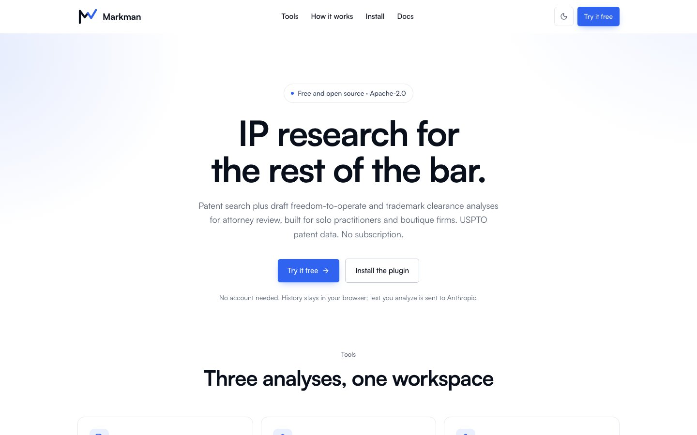
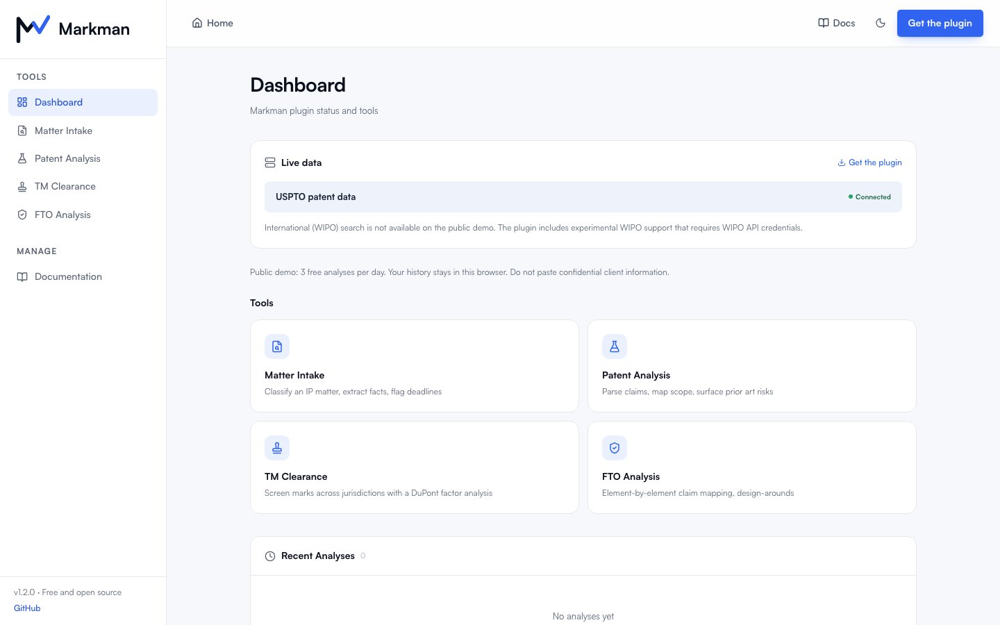
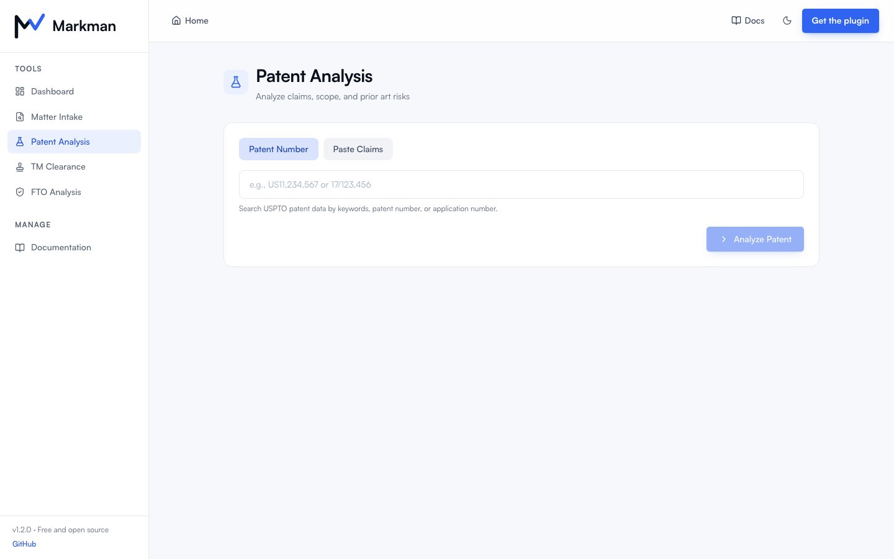
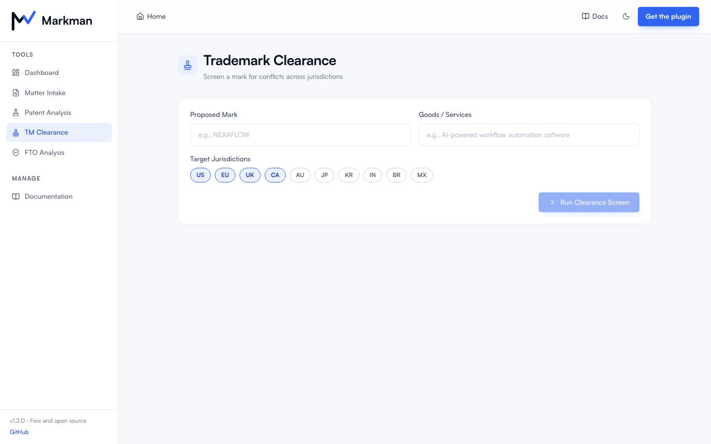

# Markman

**Try it in your browser:** [markman-ip.fly.dev](https://markman-ip.fly.dev) (free public demo, 3 analyses per day; no account needed).

A free, open-source Claude Code plugin for intellectual property work, built for solo practitioners and boutique firms. It drafts patent claim analyses, freedom-to-operate (FTO) risk analyses, trademark clearance screens, and matter intake summaries for attorney review, and adds deadline tracking, matter history, and Word export. Patent lookups use USPTO data when you add a free API key.

Free and open source. No subscription, no seat licenses. Apache-2.0.

**Markman does not provide legal advice.** Output is a draft and must be reviewed by a licensed attorney. Using Markman does not create an attorney-client relationship, and it is not a substitute for professional judgment.









## What it does

Markman teaches Claude Code how to do structured IP work. You describe what you need in natural language. Claude reads the skill definitions, calls the USPTO API (and the WIPO API, if you have a WIPO key) through MCP servers, references your firm's playbook for risk thresholds and standards, and drafts structured analysis for attorney review.

```
You: Analyze the claims in US X,XXX,XXX

Claude: [reads patent-analysis skill]
        [calls get_patent_details via USPTO MCP server for the record:
         title, dates, status, parties, classifications, transactions]
        [asks you to paste the claims; the USPTO API does not return claim text]
        [references playbook for claim drafting preferences]
        [drafts a claim map, scope assessment, and prior art flags for review]
```

## Quick start

Requires [Claude Code](https://claude.com/claude-code) and Node.js 18 or later.

In Claude Code, run:

```
/plugin marketplace add Muna0/markman
/plugin install markman@markman
```

The skills and commands work right away on patents and marks you paste in. To add live USPTO lookups, set up a free API key (below) and restart Claude Code.

## Components

**Skills** (can activate automatically when your request matches, or when you ask for them):
- `patent-analysis`: parse claims, map scope, flag Alice and KSR issues
- `fto-memo`: draft FTO analysis for attorney review: element-by-element claim mapping, possible non-infringement positions, design-around ideas
- `trademark-screen`: likelihood-of-confusion analysis using the relevant DuPont factors, phonetic variants, jurisdiction coverage
- `ip-triage`: classify IP type, extract facts, identify deadlines, assign risk

**Commands** (invoke explicitly):
- `/review-claims`: analyze a patent by number or pasted claims
- `/fto-analysis`: draft FTO analysis for a described technology
- `/tm-clearance`: screen a proposed trademark
- `/deadlines`: view, add, and manage tracked IP deadlines
- `/history`: search past analyses
- `/export-memo`: export analysis as a Word document marked as a draft for attorney review

**MCP servers** (3 servers, 12 tools):
- `uspto`: patent application search and record details (bibliographic data and transaction history, no claim text) from the USPTO Open Data Portal API (api.uspto.gov); trademark status by serial number through TSDR
- `wipo`: experimental international patent search and PCT application lookup; requires WIPO API credentials
- `markman-store`: deadline tracking, matter history, Word export (stored locally in `~/.markman/data`)

**Playbook** (configurable, `playbooks/ip-playbook.md`):
- FTO risk thresholds (HIGH, MEDIUM, LOW with required actions)
- Trademark clearance jurisdictions and recommendation thresholds
- Patent claim drafting preferences
- Deadline rules with alert intervals (90, 60, 30, 7 days)

## API keys (optional)

The plugin reads keys from your shell environment, not from a `.env` file. Add them to `~/.zshrc` (or `~/.bashrc`), then restart Claude Code:

```bash
export USPTO_API_KEY="your_key"
export WIPO_API_KEY="your_key"   # optional, experimental
```

**USPTO** (free): Sign in at [data.uspto.gov/myodp](https://data.uspto.gov/myodp) with a USPTO.gov account verified through ID.me, then open Manage API Key. USPTO requires four profile fields (job title, organization type, organization name, intended use) before a key works. New keys can take a couple of minutes to activate.

**WIPO** (experimental): WIPO support requires WIPO API credentials; see WIPO's current access terms. WIPO CASE is a system for participating patent offices, and PATENTSCOPE programmatic access is a paid WIPO subscription ([PATENTSCOPE data products](https://www.wipo.int/en/web/patentscope/data/index)). Without credentials, search the free [PATENTSCOPE](https://patentscope.wipo.int) website and paste what you find.

**Trademark search**: USPTO offers no API for trademark search by text. Markman points you to [USPTO Trademark Search](https://tmsearch.uspto.gov) for the knockout search and runs the clearance analysis on what you find. Trademark status lookup by serial number depends on USPTO's TSDR service, which was not responding reliably as of October 2026; it uses your USPTO key. It is not available on the public demo.

Without keys, the servers still start and explain how to add a key. The skills work on text you paste in.

## Usage

Once installed, use Markman by talking to Claude Code naturally or using slash commands:

```
# Natural language (skills can activate automatically)
You: We're developing an ML recommendation engine. Need to check
     if it infringes any existing patents.

# Slash commands (explicit invocation)
You: /review-claims US X,XXX,XXX
You: /tm-clearance NEXAFLOW | SaaS workflow software | US, EU, UK
You: /fto-analysis Transformer-based medical NER with FHIR output

# Deadline management
You: /deadlines
You: /deadlines add "ML Patent" "Provisional filing" "2026-05-15"

# Search past work
You: /history patent
You: /history NEXAFLOW

# Export to Word
You: /export-memo
```

## Web dashboard (optional)

The repo also includes a web dashboard for patent search, FTO, and trademark clearance. A public demo runs at [markman-ip.fly.dev](https://markman-ip.fly.dev) with `MARKMAN_PUBLIC=1`: 3 analyses per visitor per day, 150 site-wide, and history kept in the visitor's browser. To run it locally:

```bash
git clone https://github.com/Muna0/markman.git
cd markman
npm install && (cd frontend && npm install)
cp .env.example .env   # web dashboard only: add USPTO_API_KEY and ANTHROPIC_API_KEY
npm run dev            # opens on http://localhost:5173
```

## Project structure

```
markman/
├── .claude-plugin/
│   ├── plugin.json               # Plugin manifest
│   └── marketplace.json          # Marketplace listing
├── .mcp.json                     # MCP server configuration
├── mcp/
│   ├── uspto-server.js           # USPTO API (4 tools)
│   ├── wipo-server.js            # WIPO API (2 tools)
│   ├── markman-store.js          # Local store (6 tools)
│   └── dist/                     # Bundled servers (no npm install needed)
├── skills/<name>/SKILL.md        # 4 skills
├── commands/                     # 6 slash commands
├── playbooks/ip-playbook.md      # Firm standards
├── server.js                     # Web dashboard API (optional)
├── lib/                          # Server helpers (rate limiter)
├── test/                         # Server tests
├── Dockerfile                    # Container build for the public demo
├── fly.toml                      # Fly.io configuration
└── frontend/                     # Web dashboard UI (optional)
```

To rebuild the bundled servers after editing `mcp/*.js`, run `npm run build:mcp`.

Run the server tests with `npm test`.

## Customization

Fork the repo and edit `playbooks/ip-playbook.md` to match your firm's standards. The playbook controls risk thresholds, jurisdiction requirements, claim drafting preferences, deadline rules, and output formatting across all skills.

## License

Apache-2.0
